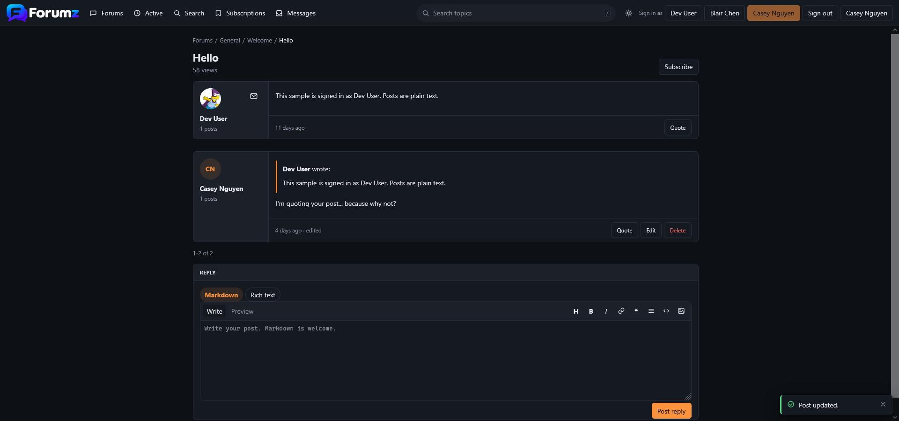
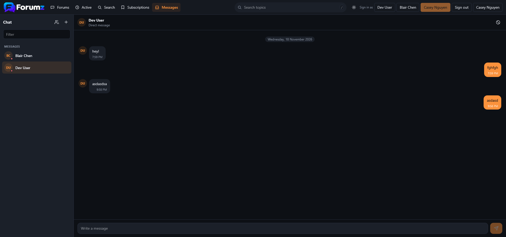

A Blazor forum you can mount in any ASP.NET Core site. It is a Razor class library, not an MVC app: the host calls `AddForumz()` and `MapForumz()`, and the pages run as their own interactive circuit.

## Screenshots





## Add it to a site

Pick the database you already use. Forumz keeps its own tables and its own migration history, so it can share the host database.

```csharp
builder.Services.AddForumz(options =>
{
    options.Title = "Forums";
    options.HomePath = "/";
    options.LogoutPath = "/Identity/Account/LogOut";
});

builder.Services.AddForumzSqlServer(connectionString);
// or AddForumzSqlite, AddForumzNpgsql, AddForumzMySql

app.MapForumz();
```

Browse to `/forums`.

Reading is anonymous. Posting needs a signed-in user. The default rules let anyone read, a signed-in user post, and an administrator (`Administrator` role) create forums and moderate. Replace `IForumAccess` to use the host's own permissions.

A multi-tenant host replaces `IForumTenantScope` and returns the current tenant on every call, including inside the Blazor circuit and on the chat hub. Null means one shared forum. Direct messages use that same tenant, so a single-tenant host does not configure chat tenancy separately.

Replace `IForumNotifier` to email subscribers. The default only logs.

`HomePath` and `LogoutPath` are full page loads. Sign-out is a normal form post, because Blazor would swallow a logout link.

Set `PublicLayout` to draw the forum under the host's own layout. Leave it null and the forum stays its own document. A host that chooses per request replaces `IForumPresentation`.

## Writing a post

A new post opens in Markdown. Register a Pickstack editor, such as `AddTinyMce8`, and the author can switch that post to rich text. `EditorMode` can lock the forum to Markdown or rich text. `DefaultContentFormat` chooses which one a new post starts in when both are available. Without a registered editor, rich text falls back to Markdown.

Markdown is rendered with Markdig, and raw HTML inside it is dropped. Rich text is stored as the author's HTML. Both are sanitized before they are shown, so a post cannot include a script.

The Markdown toolbar has an image button.

- A registered Pickstack file manager, with `UseFileManager` left at its default of true, opens that manager.
- `UseFileManager` set to false uploads a JPEG, PNG, GIF, or WebP of up to 2 MB from the author's computer. The file is saved in Pickstack's upload folder, the same place the file manager uses, so it is listed there if the manager is turned on later.

The rich text editor does not open the file manager when `UseFileManager` is false. It keeps that editor's own insert dialog. Other editors on the same site are unchanged.

A host that adds WebFilez must let Pickstack map the Blazor circuit at `/_blazor`. The forum circuit is under `/forums`. Call `UseHostBlazor()` only when the host already maps a circuit at the site root.

## What you can do

- Browse groups and forums, start topics, and reply.
- Edit or delete your own posts, when settings allow it. Moderators can edit any post, move a topic, and remove it.
- Search subjects and posts, and follow the newest replies.
- Subscribe to a forum or a topic.
- Send a direct message from a post. The first time, the other person is asked to connect. After they accept, you can chat and see when they are online. Rooms are off.
- Set a display name, a signature, and a profile photo. The built-in photo store uses `ProfilePhotoPath` under wwwroot. Replace `IProfileProvider` to store photos somewhere else.
- RSS at `/forums/feed` and `/forums/forum/{id}/feed`.
- Create groups and forums, and change settings, from the forum home. Those controls are shown to someone who can manage the forum.

## Sample

`Forumz.Sample` seeds a welcome forum on an empty database. It opens signed in as Dev User, an administrator. The top bar switches to Blair Chen or Casey Nguyen. Messages is EasyChatz with rooms turned off, so those three can write to each other directly. The sample registers TinyMCE. WebFilez is commented out in `Program.cs`.

```bash
dotnet run --project Forumz.Sample
```

## Support

If you find this project useful, consider supporting its development.

<p align="center">
  <a href="https://buymeacoffee.com/vnmatt">
    
  </a>&nbsp;&nbsp;&nbsp;
  <a href="https://www.paypal.com/cgi-bin/webscr?cmd=_donations&business=gordon_matt%40live%2ecom&lc=AU&currency_code=AUD&bn=PP%2dDonationsBF%3abtn_donateCC_LG%2egif%3aNonHosted">
    
  </a>
</p>

<p align="center">
  Prefer using your phone? Scan the QR code:
</p>

<p align="center">
  <a href="https://buymeacoffee.com/vnmatt">
    
  </a>
</p>

